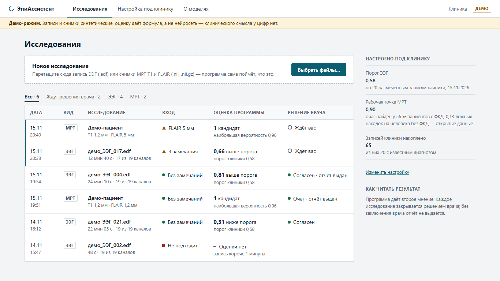
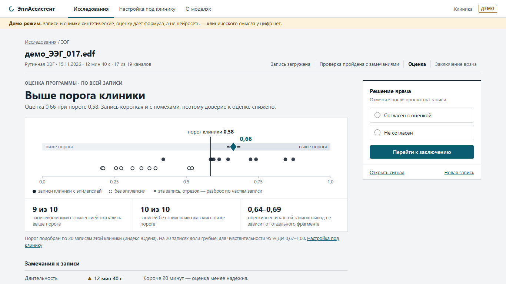
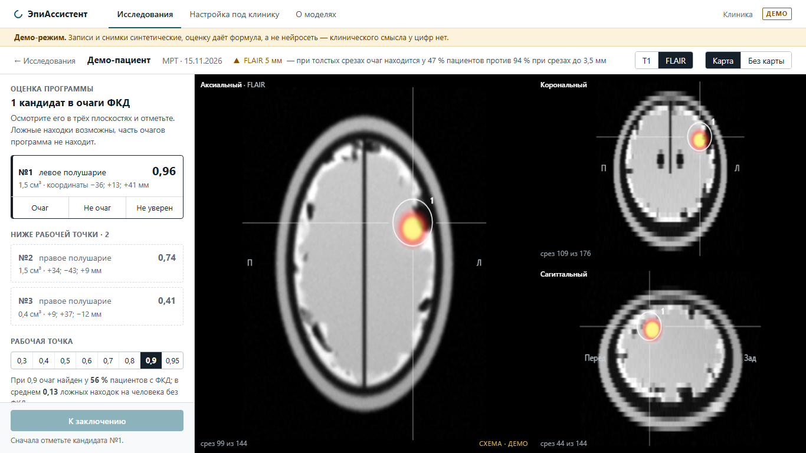
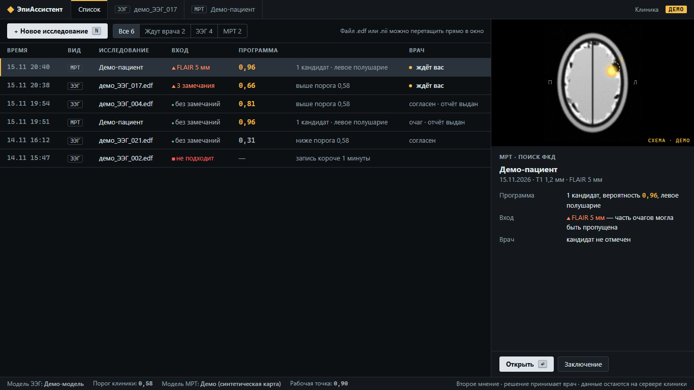
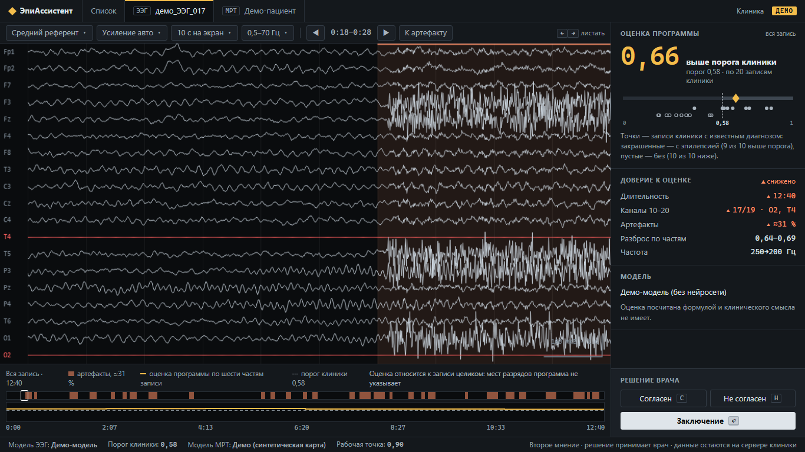
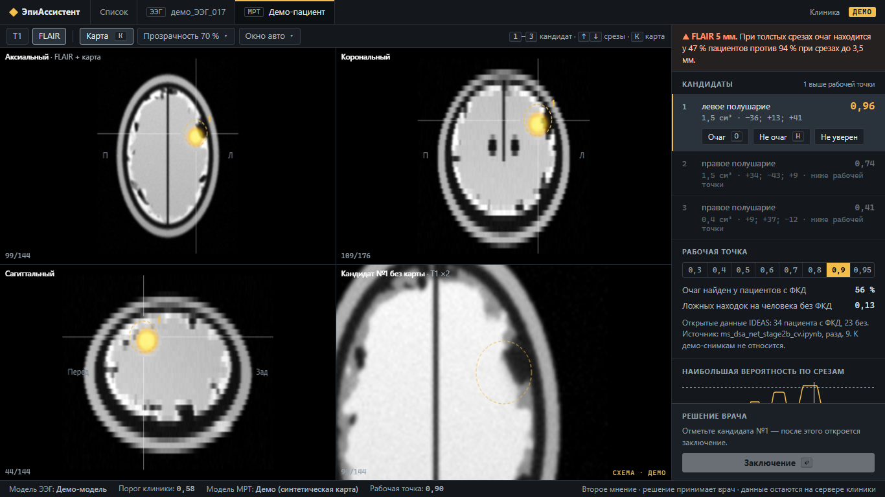
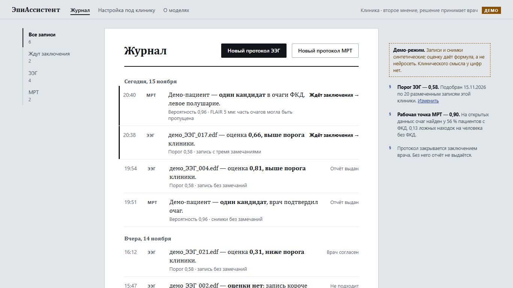
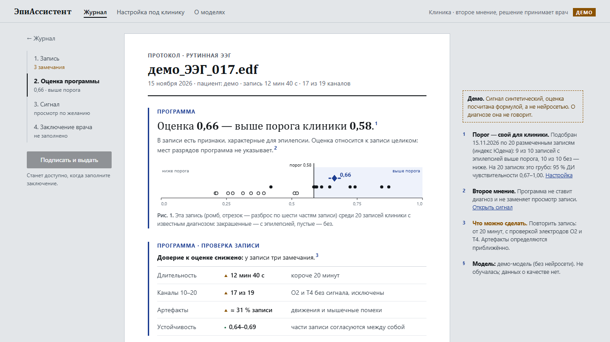
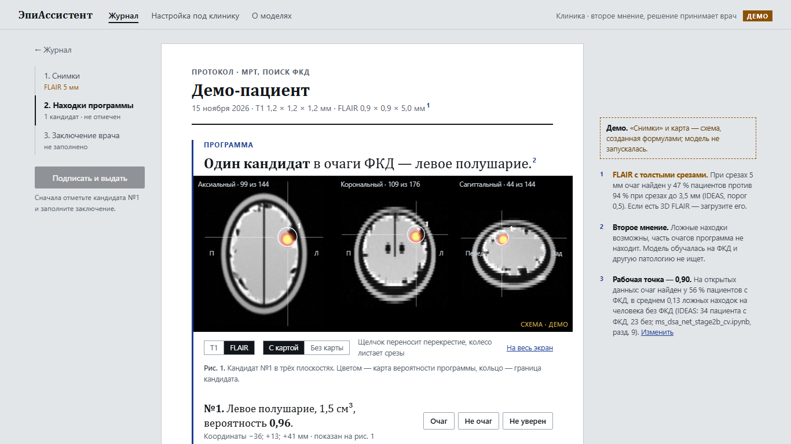

# Новый интерфейс «ЭпиАссистента»: три направления на выбор

Этап 1 переделки интерфейса, 15.11.2026. Здесь — разбор текущего интерфейса, что подсмотрено у медицинских продуктов и три
направления на трёх ключевых экранах. **Дальше работа стоит: нужно выбрать направление** (можно смешать — см. конец файла).

Как смотреть: открыть HTML двойным щелчком (интернет не нужен) и переключать экраны в тёмной полосе сверху.
Данные во всех макетах одни и те же и сняты с демо-режима приложения: синтетический сигнал, «снимки»-схема, оценки демо-модели.

| | Главная | Результат ЭЭГ | Рабочее место МРТ |
|---|---|---|---|
| **A · «Приём»** — [A_priem.html](A_priem.html) |  |  |  |
| **B · «Пульт»** — [B_pult.html](B_pult.html) |  |  |  |
| **C · «Протокол»** — [C_protokol.html](C_protokol.html) |  |  |  |

## 1. Что не так сейчас

Прошёл в демо весь путь: ЭЭГ от загрузки до отчёта, МРТ от загрузки до рабочего места, настройку под клинику (окно 1366 × 768).

**Где терялся**

1. **Главная ничего не делает.** Половину экрана занимает картинка мозга с названием, под ней две плитки. Список уже загруженных
   исследований на главной не виден — он спрятан в левой колонке рабочего места.
2. **Два способа делать одно и то же.** «Рабочее место» и «пошаговый режим» показывают одни данные по-разному; на плитке одна
   ссылка крупная, вторая мелкая («или пошаговый режим»). Непонятно, какой путь основной и чем они отличаются.
3. **Навигация меняется от экрана к экрану.** В пошаговом режиме в шапке есть вкладки «Г1 · ЭЭГ» и «Г2 · МРТ», в рабочем месте
   они пропадают. «Г1» и «Г2» — наши внутренние названия гипотез, врачу они ничего не говорят.
4. **Результат ЭЭГ: главное не за секунду.** На экране спорят стрелочный прибор, плашка «Выше порога», заголовок вывода и
   четыре цветные плашки подряд (серая, две жёлтые, синяя). Все плашки одного веса — что из них важно, не видно. Стрелка
   «спидометра» намекает на точность, которой у оценки нет.
5. **Новизна спрятана.** Порог клиники — это мелкая строка под оценкой и ссылка «⚙ Настройка под клинику» в углу. На результате
   не видно, *почему* порог именно такой и как запись выглядит среди записей этой клиники.
6. **Решение врача оторвано от результата.** В пошаговом режиме его нет вовсе (сразу «Сформировать отчёт»), в рабочем месте
   оно в самом низу правой панели, под сгибом экрана. В МРТ кандидата нельзя ни подтвердить, ни отклонить.
7. **Рабочее место — вставка, а не экран.** Скруглённая рамка с тенью посреди страницы, под ней ещё и пояснительная строка,
   которая уезжает под нижний край. У МРТ в правую панель не помещаются ни рабочая точка, ни решение.
8. **Проверка записи:** четыре карточки с цветной полосой слева, схема головы, сигнал — и главная кнопка «Всё равно
   рассчитать» под сгибом. Что именно плохо и что с этим делать — надо собирать по карточкам.

**Вид.** Узнаваемый «шаблонный» набор: сиренево-мятные градиенты на фоне и плитках, карточки со скруглением 18–28 px и тенью,
градиентная надпись, круглые шаги, плашки-предупреждения стопкой, значки ⚙ ⚠ ✓ ✕ ◉ символами. Всё одного веса, сетки нет.

**Тексты.** «Г1 · ЭЭГ: вероятность эпилепсии» (внутренний жаргон), «Всё равно рассчитать», «Сформировать отчёт» →
«Выдать отчёт · Печать / PDF» (два названия одного шага), «рабочая точка» без объяснения, длинные оговорки одним абзацем.

**Доступность** (WCAG 2.1 AA, контраст посчитан по цветам из `web/css/app.css`):

| Что | Сейчас | Норма |
|---|---|---|
| Серый текст на фоне страницы (`#6b7387` на `#f5f3fa`) | 4,3 : 1 | 4,5 |
| Текст предупреждения (`#9c6a12` на `#fff5e3`) | 4,3 : 1 | 4,5 |
| Ссылки и белый текст на главной кнопке (`#5f72c9`) | 4,4 : 1 | 4,5 |
| Активная вкладка (`#5f72c9` на `#eceffb`) | 3,9 : 1 | 4,5 |
| Плашка «Ниже порога» (`#3d9471` на `#e4f4ec`) | 3,3 : 1 | 4,5 |
| Записи в списке, варианты настройки, строки таблицы — `div` и `tr` со щелчком | с клавиатуры недоступны | 2.1.1 |
| Состояние проверки — только цвет полосы слева | цветом без слова/формы | 1.4.1 |
| Свой вид фокуса | нет | 2.4.7 |
| Сигнал и срезы на canvas | без текстового описания | 1.1.1 |

**Что хорошо и остаётся:** честные оговорки (модель не показывает места разрядов, ДЕМО, порог не настроен), настоящий сигнал
и срезы, настройка порога по записям клиники с доверительными интервалами, отказ в отчёте без заключения врача.

## 2. Что подсмотрено у медицинских продуктов

Все ссылки открыты 15.11.2026. Страницы производителей — рекламные: про устройство экранов там мало, это отмечено.

| Продукт | Что увидели | Что берём |
|---|---|---|
| **Persyst**, вероятность приступа — https://persyst.com/seizure-detection-and-seizure-probability | Оценка от 0 до 1, событие поднимается при превышении «порога, заданного пользователем»; из тренда — переход к сигналу; сигнал и тренд на одном экране | Шкала 0–1 с порогом как главный образ результата ЭЭГ. Тренд по секундам **не берём**: наша модель места не указывает |
| **Persyst**, подавление артефактов — https://www.persyst.com/technology/artifact-reduction/ | «Исходная ЭЭГ всегда показана на фоне» — видно, что именно убрала программа | Работа программы не заслоняет исходные данные: карту МРТ можно снять одним нажатием, рядом — срез без карты |
| **SCORE-AI / autoSCORE** — https://pmc.ncbi.nlm.nih.gov/articles/PMC10282956 | Один вывод на всю запись; специалист может «поправить автоматическую оценку» | Оценка относится к записи целиком; рядом с ней — решение врача |
| **encevis** — https://www.encevis.com/ | «Часы ЭЭГ одним взглядом»; подавление артефактов включается и выключается. Устройство экранов на странице не описано | Полоса всей записи с артефактами под сигналом |
| **MELD Graph**, чтение отчёта — https://meld-graph.readthedocs.io/en/latest/interpret_results.html | Первая страница — все кластеры, дальше по странице на кластер: полушарие, размер, место, уверенность. Прямо написано: «ложные кластеры будут», смотреть «с опытным рентгенологом» | Список кандидатов + разбор каждого; оговорка о ложных находках стоит рядом со списком, а не в конце |
| **Quantib ND** (сводка 510(k)) — https://fda.innolitics.com/device/K182564 | Сегментацию пользователь должен «просмотреть и при необходимости» поправить до подтверждения; назначение — «дополнительные сведения» для специалиста | Заключение закрыто, пока врач не отметил каждого кандидата выше рабочей точки |
| **icobrain ep** — https://icometrix.com/services/icobrain-ep | Объёмы «и их перцентили» — число пациента рядом с нормой | Запись пациента показана среди записей клиники с известным диагнозом |
| **Brainomix 360 Stroke** — https://www.brainomix.com/stroke/ | Сначала число (ASPECTS), потом цветная карта и три плоскости; результат возвращается сериями и PDF-отчётом | Порядок «число → картинка → отчёт» |
| **Viz.ai** — https://www.viz.ai/ | Везде слово «suspected» — подозрение, а не диагноз | Слова: «кандидат», «оценка программы», «выше порога» — не «найдено» и не «диагноз» |
| **OHIF Viewer** (открытый просмотрщик PACS) — https://docs.ohif.org/user-guide/viewer/ | Слева серии, в центре снимок, справа список измерений; щелчок по строке показывает её на снимке | Расположение рабочего места МРТ |

Не открылись или пустые по сути: `natus.com/neuro/autoscore` (403), `icometrix.com/services/icobrain-mr` (404), страница Aidoc
(про экран ничего), решение FDA по Viz.ai ContaCT (PDF не прочитался). Из них ничего не взято.

## 3. Три направления

Общее для всех трёх — то, чего нет сейчас:

- **Главная — список исследований** с тремя вещами в строке: вход, оценка программы, решение врача. Видно, что ждёт врача.
- **Один путь вместо двух.** «Пошаговый режим» и «рабочее место» слиты: у исследования одна страница.
- **Порог клиники виден в результате:** запись стоит на шкале среди 20 записей клиники с известным диагнозом (точки — настоящие
  оценки из демо-набора). Рядом простыми словами: «9 из 10 записей с эпилепсией выше порога».
- **Решение врача — главный шаг экрана.** В МРТ у каждого кандидата «Очаг / Не очаг / Не уверен»; заключение закрыто, пока
  кандидат не отмечен.
- **Оговорки не стопкой плашек,** а по месту: замечания к записи — таблицей, «не показывает места разрядов» — строкой у сигнала
  или сноской, ДЕМО — одной постоянной меткой.
- Состояние — формой и словом (▲ замечание, ● без замечаний, ■ не подходит), а не только цветом. Значки нарисованы, без эмодзи.
  Шрифты системные, внешних файлов нет.

### A · «Приём» — светлое клиническое

**Идея.** Спокойная светлая программа «как в хорошей больничной системе»: белые поверхности, тонкие линии вместо карточек с
тенью, один сине-зелёный акцент, таблицы. Результат читается сверху вниз: вывод словами → шкала → три числа → замечания; справа
закреплён блок «Решение врача».
**Для кого.** Врач, который открывает программу несколько раз в неделю, и руководитель, которому её показывают: знакомо и
понятно без объяснений.
**Чем лучше текущего.** Есть сетка и иерархия: на результате один крупный вывод и одна главная кнопка; новизна (порог клиники)
в центре экрана; контраст текста от 4,9 : 1.
**Слабое место.** Самое привычное и поэтому наименее запоминающееся; просмотр МРТ — тёмное окно внутри светлой программы.

### B · «Пульт» — тёмная рабочая станция

**Идея.** Экран не прокручивается, как в программах ЭЭГ и PACS: просмотр в центре, оценка и решение — в правой панели, внизу
строка состояния (модель, порог, рабочая точка). Открытые исследования — вкладки сверху. Всё, что нарисовала программа (оценка,
карта, контур кандидата, линия по частям записи), — одним янтарным цветом; замечания — коралловым. Числа моноширинные. У каждого
действия — клавиша.
**Для кого.** Нейрофизиолог и рентгенолог, которые сидят в программе часами и работают в затемнённой комнате.
**Чем лучше текущего.** Сигнал и срезы получают весь экран, а не рамку посреди страницы; в четвёртом окне МРТ — кандидат крупно
**без карты** (карта не заслоняет анатомию); решение врача всегда на виду внизу панели.
**Слабое место.** Плотно: новичку и руководству на защите сложнее. Сигнал ЭЭГ рядом с оценкой подталкивает искать «где разряд» —
поэтому под сигналом строка «мест разрядов программа не указывает» и почти ровная линия оценки по частям записи.

### C · «Протокол» — исследование как документ

**Идея.** Каждое исследование — лист протокола: слева содержание и кнопка «Подписать и выдать», в центре лист, справа поля.
На листе два голоса: **«Программа»** (синяя линейка) и **«Врач»** (чёрная линейка) — видно, где кончается машина и начинается
человек. Вывод написан предложением: «Оценка 0,66 — выше порога клиники 0,58». Оговорки — пронумерованные сноски на полях
напротив того, к чему относятся. Заключение врача — на той же странице; то, что на экране, и есть отчёт. Главная — журнал по дням.
**Для кого.** Врач, чей результат работы — заключение, и клиника, которой важен документ. Хорошо показывает «второе мнение,
решение за врачом» — это видно из самого устройства страницы.
**Чем лучше текущего.** Нет отдельного шага «отчёт»; оговорки перестали быть шумом; печать совпадает с экраном.
**Слабое место.** Срезы МРТ — рисунок в листе, а не рабочее окно: для внимательного осмотра нужен режим «на весь экран» (его
придётся делать отдельно). Требует аккуратных формулировок.

## 4. Сравнение

| | A · «Приём» | B · «Пульт» | C · «Протокол» |
|---|---|---|---|
| Главное за секунду (результат ЭЭГ) | вывод словами + шкала | число 0,66 + сигнал | вывод предложением + шкала |
| Понятно без инструкции | да | после короткого знакомства | да |
| Удобство при потоке исследований | среднее | высокое | среднее |
| Осмотр МРТ | хорошо (крупный аксиальный срез) | лучше всех (4 окна, срез без карты) | слабее (рисунок + «на весь экран») |
| «Решение за врачом» в самом устройстве | блок справа | блок внизу панели | вся страница — две части: программа и врач |
| Новизна (порог клиники) на виду | в центре результата | в правой панели, мелко | в листе + сноска «порог — свой для клиники» |
| Показ на защите руководству | спокойно, понятно | «профессионально», но плотно | необычно, легко объяснять |
| Отличие от «типового ИИ-макета» | умеренное | сильное | сильное |
| Объём работы на этапе 2 | меньше всех | больше всех (клавиши, вкладки, плотная вёрстка) | средний + полноэкранный просмотр МРТ |
| Узкое окно 1366 px / экран 1920 px | проверено / проверено | проверено / проверено | проверено / проверено |

Контраст основного и вторичного текста во всех трёх — не ниже 4,5 : 1 (посчитан по цветам макетов).

## 5. Что нужно решить

1. **Какое направление берём.** Направления можно смешать. Самое естественное сочетание: один визуальный язык, а экран
   просмотра МРТ и сигнала — всегда тёмная рабочая область по образцу B (в A и C он и так тёмный).
2. **Шрифт.** Макеты сделаны на системных шрифтах (Segoe UI, Cambria, Cascadia Mono / Consolas). На рабочей машине с Ubuntu
   сервер только отдаёт страницы, шрифт берётся с компьютера врача, так что вид будет разным. Если нужен одинаковый — положу
   шрифт в `app/web/` (спрошу отдельно: что, откуда, размер, лицензия).

Файлы: `assets/demo-data.js` — данные демо-режима (сняты с сервера), `assets/demo-kit.js` — рисование сигнала и срезов для макетов.
