# REVE v4 и разбор ошибок модели (Г1, ЭЭГ)

*Захар Санников, 27.10.2026. Блокноты: `notebooks/h1_2026-10-27_zs_reve-v4.ipynb` (Kaggle `zakharsann/h1-reve-v4`) и `notebooks/h1_2026-10-27_zs_reve-errors.ipynb` (Kaggle `zakharsann/h1-reve-errors`).*

## Коротко

1. **Новые случайные окна на каждой эпохе не дали прироста.** Переобучение сдвинулось на 1–2 эпохи позже: лучшие эпохи 3, 1 и 2 (у v2 все три — первая). Качество осталось прежним: разница с REVE v2 на NMT eval и в Турции от −0,015 до +0,002 ROC AUC, все интервалы включают 0. Оценки v4 и v2 почти совпадают (Спирмен 0,95–0,98).
2. **Модель сильнее всего реагирует на амплитуду, хотя каждое окно нормируется по амплитуде.** Внутри каждого класса чем выше амплитуда записи, тем выше оценка (Спирмен +0,34…+0,57, везде значимо). Ложные тревоги на NMT — это «нормы» с высокой амплитудой (медиана 38 мкВ против 16 у верно распознанных). Пропуски — больные с низкой амплитудой: в Турции 17 мкВ против 34 мкВ у распознанных.
3. **Морганий модель почти не замечает, мышечная помеха снижает оценку.** Чем больше мышечной помехи, тем ниже оценка (Спирмен −0,46…−0,58). С морганиями связи нет.
4. **Внутри записи модель поднимает оценку на окнах с резкими всплесками амплитуды** (средний Спирмен +0,21…+0,51). Если закрыть секунду окна (сделать её плоской), оценка почти всегда растёт: модель реагирует на резкие перепады сигнала.
5. **Исключение «артефактных» окон без переобучения не помогло.** Ни один вариант не улучшил ROC AUC на отложенных 15 % больше чем на 0,003. На NMT eval и в Турции изменения в пределах ±0,015, интервалы включают 0.

## Часть A. REVE v4

**Что изменили.** В REVE v2 модель на каждой эпохе видела одни и те же 8 окон каждой записи. Лучшей всегда оказывалась первая эпоха: модель запоминала окна. В v4 за эпоху модель видит столько же окон, но каждое вырезано заново со случайного места своей записи. Остальное как в v2: `brain-bzh/reve-base`, окна 10 с, нормировка окна, те же аугментации, скорость основы 1·10⁻⁵, головы 5·10⁻⁴. До 10 эпох, остановка, если 2 эпохи подряд ROC AUC на отложенных 15 % не растёт. 3 запуска. Данные — общий набор `h1-prep-shared` с тем же делением на обучение и отложенные 15 %.

**Эпохи** (ROC AUC отложенных 15 %, 12 окон на запись):

| Запуск | По эпохам | Лучшая | Остановка |
|---|---|---|---|
| 0 | 0,867 → 0,877 → **0,879** → 0,879 → 0,876 | 3 | плато, 5 эпох |
| 1 | **0,887** → 0,884 → 0,875 | 1 | плато, 3 эпохи |
| 2 | 0,866 → **0,889** → 0,865 → 0,849 | 2 | плато, 4 эпохи |

У v2 было 0,879 / 0,879 / 0,880, и лучшей всегда была первая эпоха. Новые окна оттянули переобучение примерно на эпоху, но выше модель не поднялась: потери на обучении падают, а ROC AUC отложенных после 2–3 эпох снижается.

**ROC AUC (95% ДИ), ансамбль 3 запусков, 60 окон на запись — те же окна, что у v2:**

| Сборка оценки записи | Набор | REVE v4 | REVE v2 | v4 − v2 (парный бутстреп) |
|---|---|---|---|---|
| медиана окон | отложенные 15 % (335) | 0,890 (0,85–0,93) | 0,888 (0,84–0,93) | +0,001 (−0,013…+0,016) |
| | NMT eval (185) | 0,882 (0,84–0,92) | 0,898 (0,85–0,94) | −0,015 (−0,036…+0,004) |
| | Турция (121) | 0,891 (0,82–0,95) | 0,889 (0,82–0,95) | +0,002 (−0,026…+0,032) |
| среднее верхних 20 % окон | отложенные 15 % | 0,906 (0,87–0,94) | 0,905 (0,86–0,94) | +0,001 (−0,009…+0,012) |
| | NMT eval | 0,917 (0,88–0,95) | 0,925 (0,89–0,96) | −0,008 (−0,027…+0,010) |
| | Турция | 0,915 (0,86–0,96) | 0,930 (0,88–0,97) | −0,015 (−0,043…+0,010) |

- По отдельным запускам: Турция 0,89 / 0,89 / 0,92, NMT eval 0,90 / 0,92 / 0,91 (верхние 20 %).
- Верхние 20 % окон снова лучше медианы: NMT eval +0,034 (+0,016…+0,054); отложенные +0,017 и Турция +0,024 — интервалы включают 0.
- Оценка по всем окнам записи вместо 60 ничего не меняет (|Δ| ≤ 0,005).
- Связь оценки с амплитудой записи в Турции: Спирмен 0,42 (медиана) и 0,59 (верхние 20 %). У v2 было 0,36.
- Ансамбль с EEG-DINO при одинаковой сборке (верхние 20 %): с v4 — 0,934, с v2 — 0,935 в Турции; разность −0,002 (−0,017…+0,015). Добавка EEG-DINO к REVE: +0,005 (−0,019…+0,032), не значима.

**Пороговые метрики** (среднее вероятностей 3 запусков, верхние 20 %; порог по Юдену на отложенных 15 % = 0,832, на другие наборы переносится без изменений). Порог по чувствительности 80 % на отложенных совпал с порогом Юдена:

| Набор | Accuracy | Сбаланс. accuracy | Precision | Recall | Специфичность |
|---|---|---|---|---|---|
| отложенные 15 % | 0,85 (0,81–0,88) | 0,83 (0,77–0,89) | 0,49 (0,38–0,60) | 0,82 (0,70–0,92) | 0,85 (0,81–0,89) |
| NMT eval | 0,82 (0,76–0,86) | 0,81 (0,76–0,87) | 0,86 (0,78–0,93) | 0,74 (0,65–0,83) | 0,88 (0,81–0,94) |
| Турция | 0,60 (0,52–0,69) | 0,52 (0,50–0,55) | 1,00 | **0,04 (0,00–0,10)** | 1,00 |

Как и раньше, порог из NMT в турецкую больницу не переносится: вероятности там ниже. Медиана окон — в `results/reve_v4_threshold_metrics.csv`.

**Калибровка порога на месте (Турция).** Порог по Юдену подбирается на k размеченных людях, метрики считаются на остальных; 500 повторов. Код и выборки те же, что в `reve_v2_turkey_local_threshold_calibration.csv`, общие 9 строк совпали. Сбалансированная accuracy, среднее (2,5–97,5 % повторов):

| k | REVE v4 | REVE v2 | REVE v4, верхние 20 % | REVE v2, верхние 20 % | v4 (верхние 20 %) + EEG-DINO | v2 (верхние 20 %) + EEG-DINO |
|---|---|---|---|---|---|---|
| 10 | 0,78 (0,62–0,85) | 0,77 | 0,79 | 0,81 | 0,83 (0,64–0,89) | 0,83 |
| 20 | 0,81 (0,72–0,86) | 0,79 | 0,80 | 0,83 | **0,85 (0,75–0,90)** | **0,85 (0,75–0,91)** |
| 30 | 0,81 (0,75–0,87) | 0,79 | 0,81 | 0,84 | 0,85 (0,78–0,90) | 0,86 |

Прирост к прошлой лучшей цифре (0,81 при 20 людях) дала сборка по верхним 20 % окон, а не v4: с v2 получается то же самое. При 20 людях у ансамбля REVE (верхние 20 %) + EEG-DINO recall 0,79, специфичность 0,91, precision 0,87.

**Скорость.** Запись 20 мин из сырого турецкого `.mat` (500 Гц), 120 окон по 10 с:

| Этап | T4 (Kaggle) | Процессор Kaggle, 4 ядра |
|---|---|---|
| Чтение файла (запись 41 мин) | 2,6 с | 2,2 с |
| Подготовка сигнала (20 мин): референт, 500→200 Гц, фильтры, окна, нормировка | 0,8 с (на процессоре) | 0,7 с |
| Загрузка весов одной модели (один раз) | 0,7 с | 0,6 с |
| Модель REVE, 1 запуск | **0,4 с** | **27 с** |
| Ансамбль REVE из 3 запусков | **1,2 с** | **82 с** |

EEG-DINO не замерялась: её дообученные веса в прошлый раз не сохранили. На процессоре ансамбль занимает ~1,5 мин на запись; для одного кабинета это приемлемо, для потока записей нужна видеокарта.

**Веса.** В выходе Kaggle-блокнота `zakharsann/h1-reve-v4` лежат `reve_v4_seed0.pt`, `reve_v4_seed1.pt`, `reve_v4_seed2.pt`, в каждом — `{"state_dict", "config"}`. Там же `reve_v4_model.py` с классом `RVNet` и функцией подготовки окна `rv_input`. Формат описан в первой ячейке блокнота. В git веса не кладём.

## Часть B. Где модель ошибается

**Как считали.** Модель — REVE v4, ансамбль 3 запусков. Оценка записи — среднее верхних 20 % окон по всем окнам записи. Для разбора ошибок порог выбран по Юдену отдельно в каждом наборе. Это описательный порог, по нему не оцениваем качество. Число случаев:
- NMT eval: 17 ложных тревог из 95 «норм», 15 пропусков из 90 «патологий»;
- Турция: 5 ложных тревог из 71 здорового, 10 пропусков из 50 больных эпилепсией.

Ложные тревоги сравнивали с верно распознанными здоровыми, пропуски — с верно распознанными больными. Метод — Манн–Уитни, поправка Бенджамини–Хохберга (q). Отдельно смотрели, как оценка связана с фактором внутри класса (Спирмен). 95% ДИ — бутстреп по людям.

### 1. Факторы записи

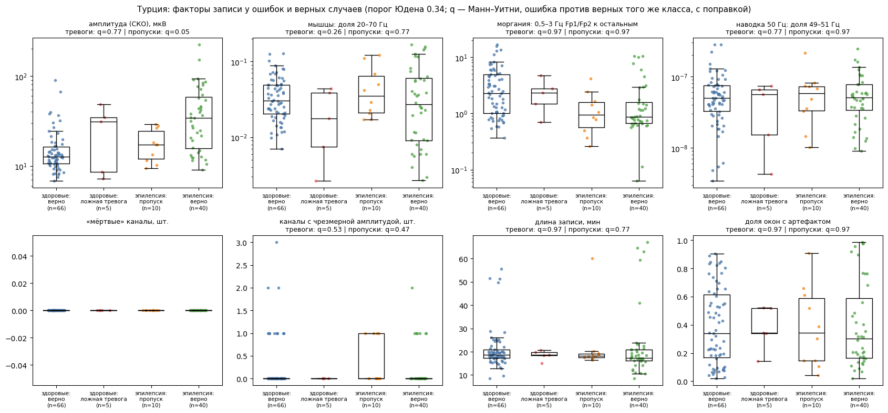
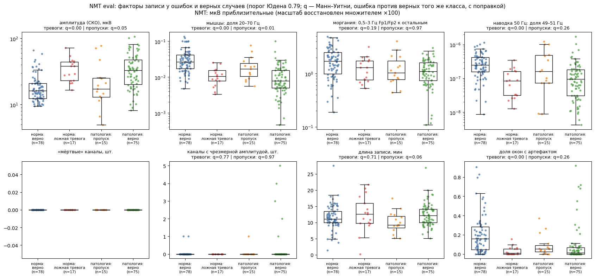
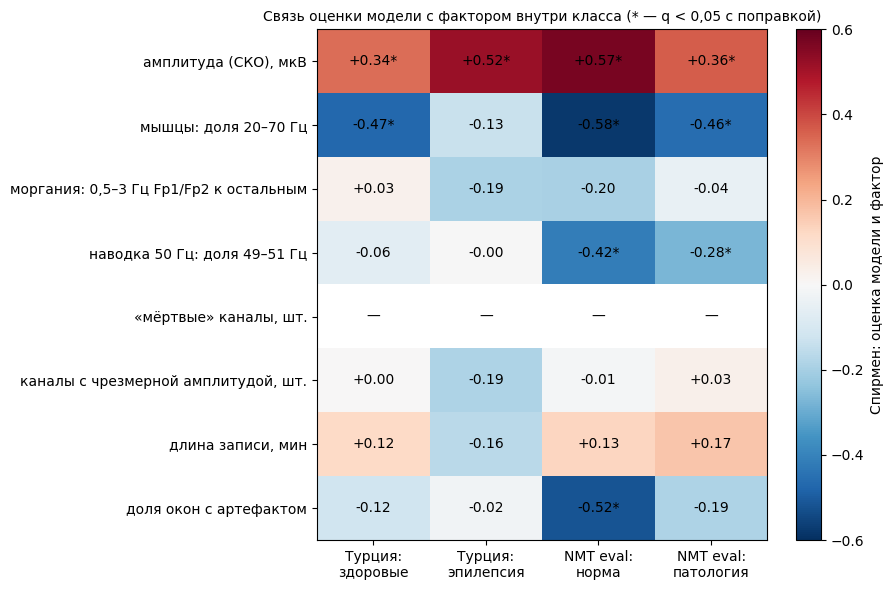

**Амплитуда — главный фактор.** Внутри каждого класса чем выше амплитуда записи, тем выше оценка модели:

| Группа | Спирмен (95% ДИ) |
|---|---|
| NMT «нормы» | +0,57 (+0,41…+0,69) |
| NMT «патологии» | +0,36 (+0,13…+0,56) |
| здоровые Турции | +0,34 (+0,08…+0,55) |
| больные эпилепсией в Турции | +0,52 (+0,27…+0,72) |

Ложные тревоги на NMT — записи с высокой амплитудой. Медиана 38 мкВ против 16 у верно распознанных «норм». Вероятность, что у ложной тревоги амплитуда выше, — 0,87 (0,80–0,94), q < 0,001. Пропуски — записи с низкой амплитудой: в Турции 17 мкВ против 34 мкВ у распознанных больных (эффект 0,24, 0,12–0,40, q = 0,05), на NMT 17 против 33 мкВ (q = 0,05). Модель видит только нормированные окна, то есть абсолютную амплитуду знать не должна. Значит, она узнаёт амплитуду по чему-то связанному с ней — например, по форме спектра: в высокоамплитудных записях больше медленных волн. Мы и раньше видели связь оценки с амплитудой (у REVE v2 Спирмен 0,36). Теперь видно, что именно эта связь даёт ошибки обоих типов.

**Мышечная помеха снижает оценку.** Чем больше доля мощности 20–70 Гц, тем ниже оценка: Спирмен −0,47 у здоровых Турции, −0,58 и −0,46 на NMT. На NMT у пропусков мышечной помехи больше, чем у распознанных больных (эффект 0,75, q = 0,014). То есть модель не «принимает мышцы за эпилепсию». Наоборот, помеха может маскировать признаки болезни. Это согласуется с амплитудой: высокочастотная помеха уменьшает долю медленных волн.

**Моргания** (мощность 0,5–3 Гц в Fp1/Fp2 к остальным каналам) **с ошибками не связаны:** все q > 0,15, Спирмен от −0,20 до +0,03.

**Наводка 50 Гц** после режекции почти нулевая (доля ~10⁻⁷). Отрицательная связь на NMT (−0,42) отражает ту же картину, что и мышечная помеха: в «тихих» записях доля высоких частот выше. Практического смысла у этой связи нет.

**«Мёртвых» каналов нет ни в одной записи.** Каналы с чрезмерной амплитудой редки (0–3 на запись) и с ошибками не связаны. Длина записи тоже не связана с ошибками (q ≥ 0,06).

**Доля окон с артефактом** (мышцы, моргания или всплеск амплитуды выше 95-го процентиля NMT): у ложных тревог NMT она ниже, чем у верных «норм» (0,8 % против 16 %, q < 0,001). Это та же амплитуда: в записях с высокой амплитудой меньше окон выделяется как «всплеск». В Турции связи нет.

Данные: `results/reve_v4_errors_factors.csv` (по людям), `results/reve_v4_errors_stats.csv` (тесты).

### 2. Оценка вдоль записи

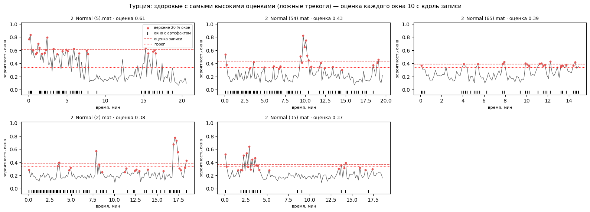
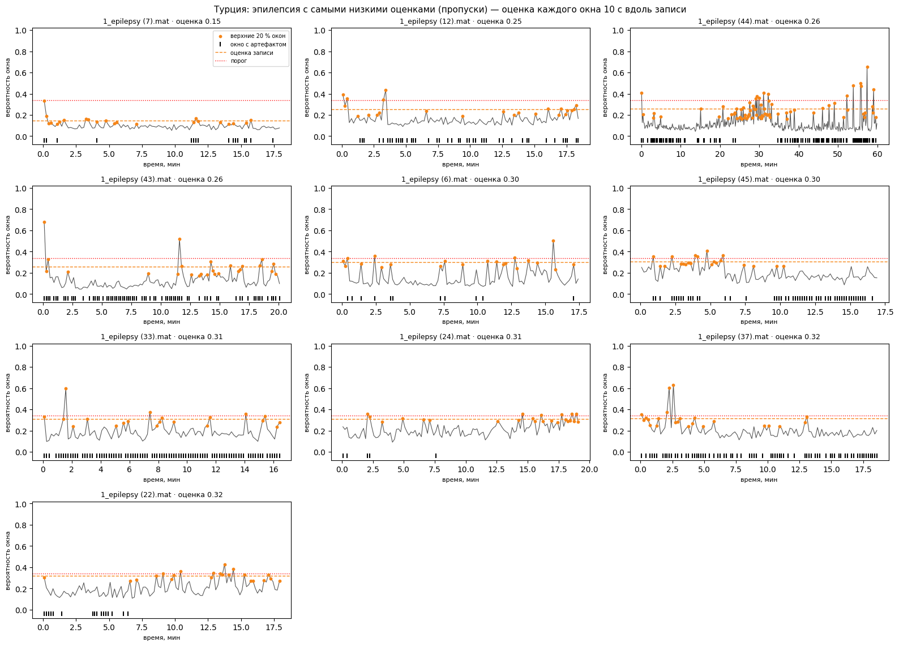
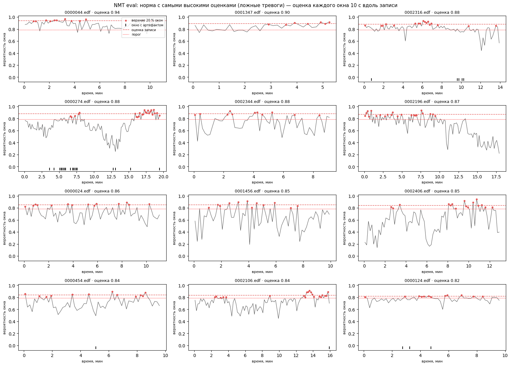
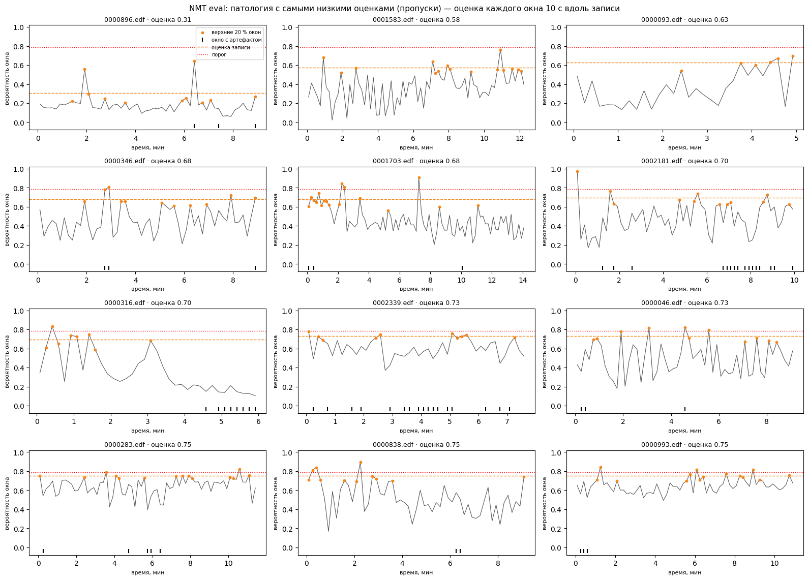
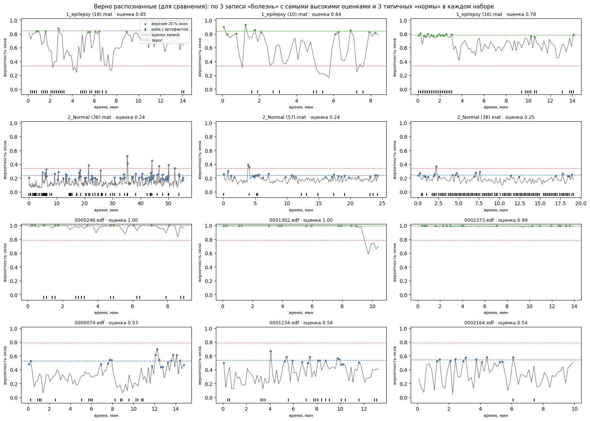

Чёрные штрихи внизу — окна с артефактом; точки — верхние 20 % окон, по которым считается оценка записи.

- **Ложные тревоги в Турции** бывают двух видов. В одних записях оценка высокая на коротком отрезке: у `2_Normal (54)` — около 10-й минуты, у `2_Normal (2)` — около 17-й. Другие записи весь начальный отрезок держатся около порога (`2_Normal (5)` — первые 8 минут).
- **У пропусков в Турции** оценка почти по всей записи 0,1–0,3, лишь изредка одиночные окна до 0,5–0,65. Модели не за что «зацепиться».
- **Края записи.** Самое подозрительное окно записи заметно чаще, чем при случайном выборе, оказывается первым или последним. У верных «норм» и пропусков так в 15–20 % записей при ожидаемых 2–4 % (`results/reve_v4_errors_edge.csv`). Причина — краевой эффект фильтра в начале и конце записи. Правило «не учитывать первое и последнее окно» мы задали заранее и проверили. ROC AUC оно не меняет: отложенные +0,001 (−0,001…+0,003), NMT eval +0,001, Турция +0,001 (−0,006…+0,008). Среднее верхних 20 % окон гасит одно краевое окно (`results/reve_v4_extra_checks.csv`).

### 3. Сигнал в самых подозрительных окнах

28 картинок: по 5 ложных тревог и 5 пропусков, по 2 верно распознанных больных и здоровых для каждого набора. Каналы друг под другом, шкала в мкВ (красная черта), средний референт, 0,3–75 Гц. Список — `results/reve_v4_errors_signal_cases.csv`. Ниже по одному примеру каждого типа, остальные — в папке `results/figures/reve_v4_errors/` (файлы `s_*.png`).

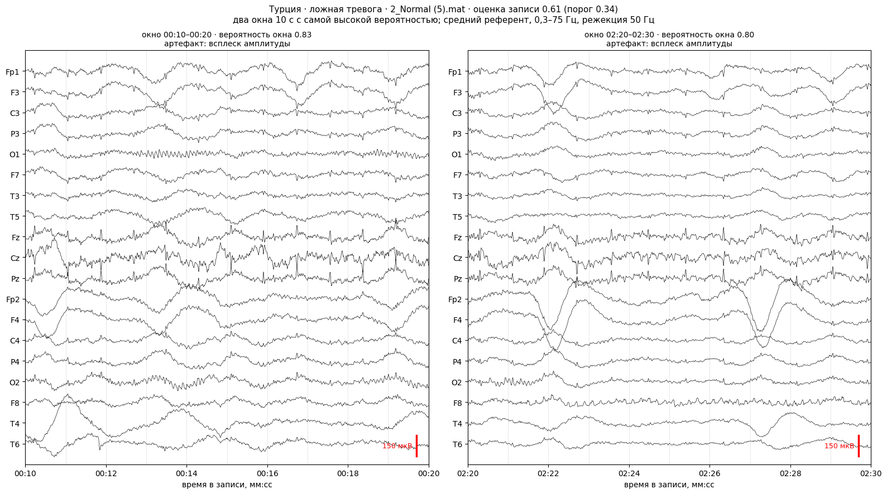
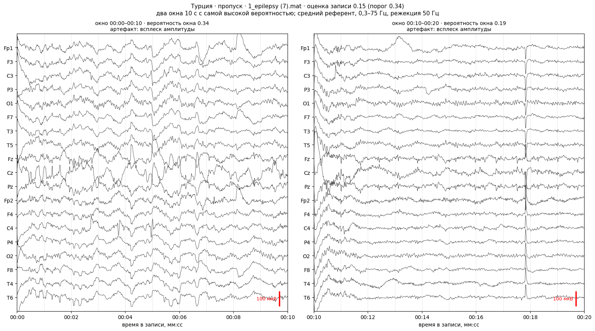
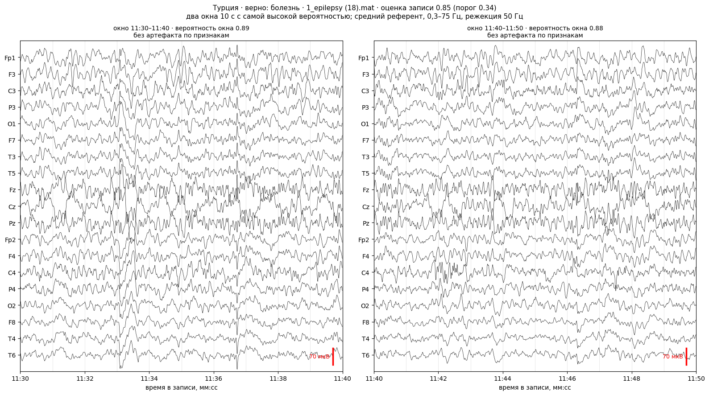
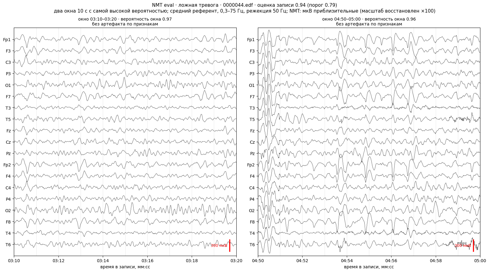
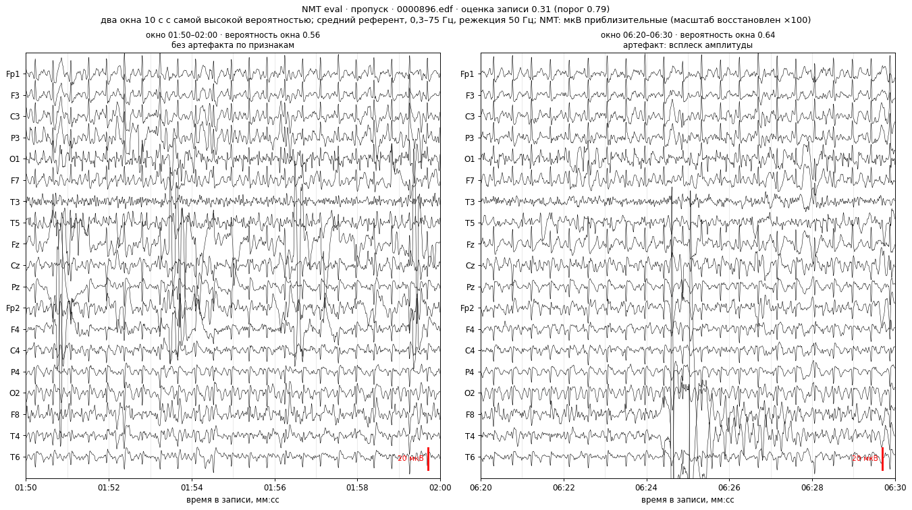

Наблюдения неспециалиста; их должен посмотреть врач.
- **`2_Normal (5)`, Турция, ложная тревога.** В подозрительных окнах — медленные колебания большой амплитуды в лобных отведениях, похожие на движения глаз. В Cz/Pz видны острые зубцы. Признаки артефакта отметили только всплеск амплитуды.
- **`0000044.edf`, NMT, ложная тревога.** Высокоамплитудная ритмичная активность во всех каналах; признаки артефакта её не отмечают. Это может быть особенность записи или ошибка разметки «нормы».
- **`1_epilepsy (7)`, Турция, пропуск.** Самое подозрительное окно — первые секунды записи (краевой эффект). Остальная запись низкоамплитудная, без явных отклонений.

### 4. На что смотрит модель (окклюзия)

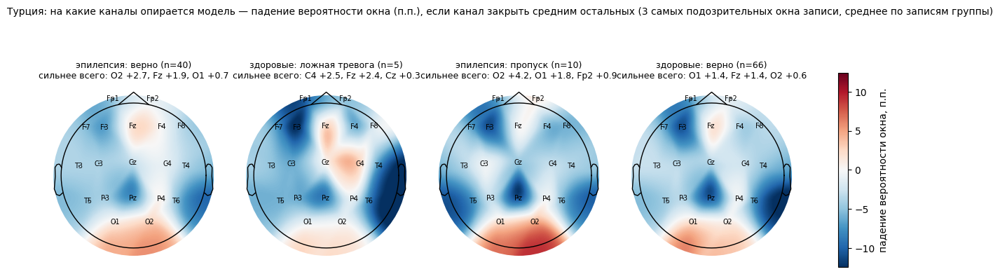
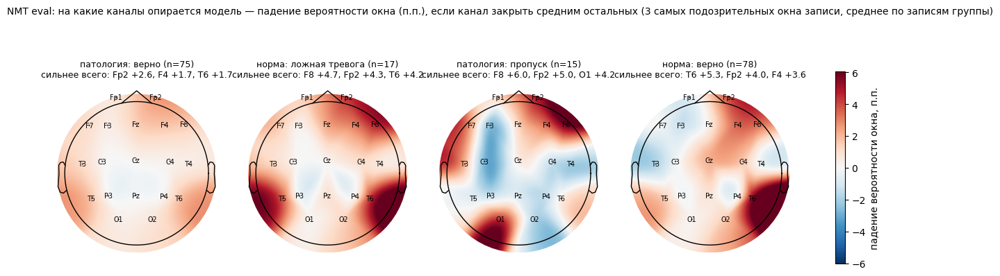
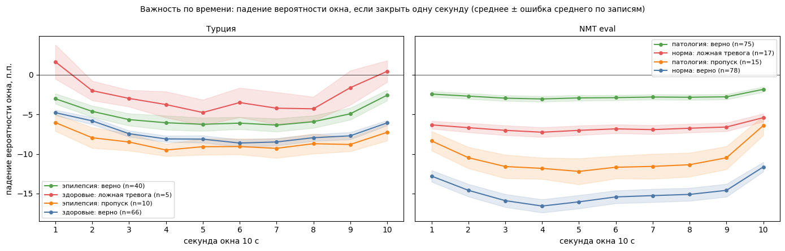

Берём 3 самых подозрительных окна каждой записи (NMT eval и Турция, 306 записей, 916 окон). По очереди закрываем каждый канал: заменяем его средним остальных. Затем каждую секунду: заменяем средним значением канала, то есть делаем плоской. Смотрим, насколько падает вероятность окна. Положительное значение — модель на этот канал или секунду опиралась.

- **Секунды.** Если сделать любую секунду плоской, вероятность почти везде **растёт**. На NMT у верных «норм» на 12–17 п.п., у пропусков на 8–12 п.п.; в Турции на 2–9 п.п. Сильнее всего это проявляется в середине окна. Значит, модель считает подозрительным резкий перепад или плоский участок. Это та же чувствительность к изменениям амплитуды, что и у признака «всплеск»: внутри записи окна со всплесками получают более высокую оценку (средний Спирмен +0,21…+0,51).
- **Каналы, Турция.** Закрытие большинства каналов тоже повышает оценку (синий цвет). Чуть важнее остальных затылочные O1/O2 и Fz: +0,7…+4 п.п. во всех группах.
- **Каналы, NMT.** Важнее правые лобные и височные каналы: Fp2, F4, F8, T6, +2…+6 п.п. Картина одинакова у верных и ошибочных случаев, поэтому особенностей ошибок карта не объясняет.
- **Оговорка.** В записи со средним референтом «среднее остальных каналов» близко к нулю. Поэтому закрытие канала тоже меняет амплитуду окна, и карты частично повторяют вывод про чувствительность к амплитуде. Метод грубый: подсказывает направление, но не доказывает.

Данные: `results/reve_v4_errors_occlusion.csv.gz`.

### 5. Простое исправление: не учитывать окна с артефактом

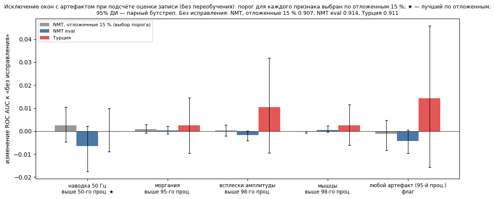

Правило: при подсчёте оценки записи пропускаем окна, где признак артефакта выше порога. Признак (мышцы, моргания, всплеск амплитуды, наводка или любой из них) и порог (50–98-й процентиль окон) выбирались только по отложенным 15 %. Без исправления ROC AUC: отложенные 0,907, NMT eval 0,914, Турция 0,911.

- **Лучший вариант по отложенным** — наводка 50 Гц выше медианы: +0,002 (−0,005…+0,010). Этот признак после режекции почти нулевой, так что выбор случайный. На NMT eval −0,007 (−0,018…+0,002), в Турции 0,000.
- **Остальные признаки на отложенных:** от −0,001 до +0,001. Исключение всплесков (выше 98-го процентиля) в Турции даёт +0,010 (−0,009…+0,032), любого артефакта +0,014 (−0,016…+0,046). Интервалы включают 0, а на отложенных и NMT eval эти варианты не лучше.

**Вывод:** выкидывание артефактных окон не помогает. Модель ошибается не из-за отдельных грязных окон, а из-за свойства всей записи — уровня амплитуды и доли медленных волн. Таблицы: `results/reve_v4_errors_fix.csv`, `results/reve_v4_errors_fix_grid.csv`.

## Насколько надёжно

- **Надёжно:** связь оценки с амплитудой. Она значима во всех четырёх группах после поправки и согласуется с прежними блокнотами.
- **Умеренно надёжно:** отрицательная связь с мышечной помехой — значима в трёх группах из четырёх.
- **Ненадёжно:** ложных тревог в Турции всего 5. Сравнения по ним почти ничего не показывают (широкие ДИ).
- **Ограничение:** порог для групп ошибок выбран внутри набора (описательно). При другом пороге состав групп изменится, но связи по Спирмену от порога не зависят.
- **Ограничение:** абсолютные мкВ у NMT приблизительные (масштаб восстановлен множителем ×100). Сравнения амплитуды делаем только внутри набора.

## Что делать дальше

1. **Ослабить опору на амплитуду при обучении.** Сильнее менять амплитуду и наклон спектра в аугментациях: случайный множитель по каналам, лёгкая фильтрация. Проверять по Спирмену с амплитудой внутри класса — так же, как здесь.
2. **Оставить сборку «среднее верхних 20 % окон» как штатную для MVP.** Прирост калибровки на месте дала именно она: при 20 людях сбалансированная accuracy 0,85 у ансамбля с EEG-DINO, 0,80–0,83 у одной REVE.
3. **Не тратить время на фильтр артефактных окон** в нынешнем виде. Отрезать края записи можно ради аккуратности, на качество это не влияет.
4. **Показать врачу 28 картинок сигнала** (особенно ложные тревоги NMT с высокой амплитудой). Нужно понять, что это: артефакт, особенность записи или ошибка разметки.
5. **На TUEP** (когда будет доступ) сразу проверить связь оценки с амплитудой: если она останется, это главный риск переноса.

## Затраты

- GPU T4: v4 — 55,8 мин, разбор ошибок — 9,9 мин, всего **≈1,1 ч** (бюджет 2,5 ч).
- Короткие проверки на процессоре Kaggle (`h1-reve-v4-smoke`, `h1-reve-errors-smoke`) GPU не тратили.
- Сравнение с v2, калибровка и проверка краевых окон считались локально по csv.

**Файлы:**
- Kaggle: `results/reve_v4_{runs,summary,threshold_metrics,per_person,speed}.csv`, `reve_v4_window_scores.csv.gz` (оценки всех окон: отложенные, NMT eval, Турция × 3 запуска), `reve_v4_speed_cpu.csv`.
- Локально: `reve_v4_vs_v2.csv`, `reve_v4_all_windows.csv`, `reve_v4_paired_differences.csv`, `reve_v4_ensembles_summary.csv`, `reve_v4_turkey_local_threshold_calibration.csv`, `reve_v4_extra_checks.csv`.
- Разбор ошибок: `results/reve_v4_errors_*.csv`, картинки — `results/figures/reve_v4_errors/` (40 PNG).
